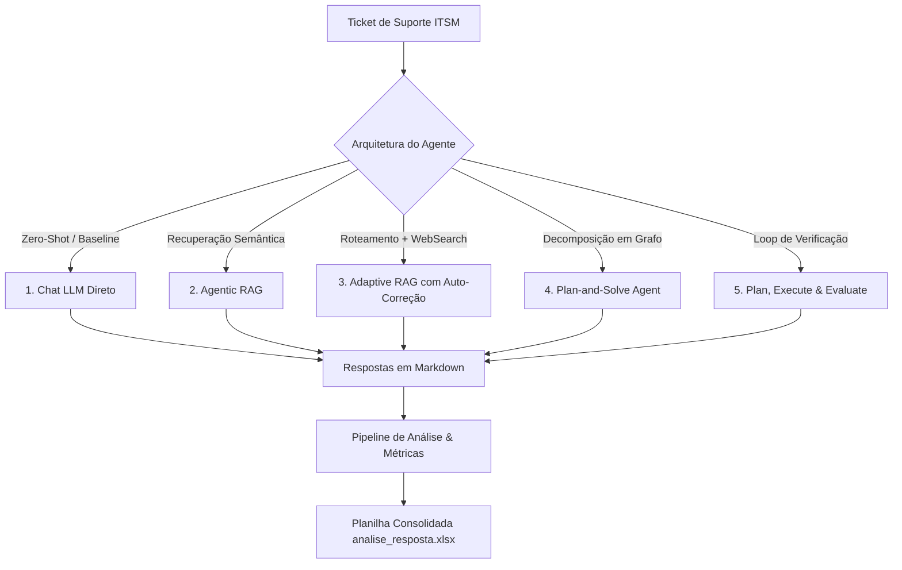

# 🤖 Plataforma de Agentes Inteligentes para ITSM & ITIL 4

[](https://www.python.org/)
[](https://ai.google.dev/)
[](https://www.langchain.com/)
[](https://www.axelos.com/certifications/itil-service-management)

Repositório dedicado à pesquisa, engenharia e avaliação comparativa de arquiteturas de **Agentes de Inteligência Artificial com Modelos de Linguagem Grande (LLMs)** aplicados ao gerenciamento de incidentes e chamados de suporte técnico em conformidade com as práticas do **ITIL 4**.

---

## 🎯 Objetivo do Projeto

Investigar e comparar a eficácia de diferentes padrões arquiteturais de agentes cognitivos na classificação e resolução de chamados de TI (*ITSM - IT Service Management*):
- Identificação precisa da **Prática Principal** e **Prática Auxiliar** do ITIL 4 (ex.: *Incident Management*, *Problem Management*, *Change Enablement*, *Service Request Management*, etc.).
- Elaboração de diagnósticos fundamentados e recomendações técnicas para analistas de suporte.
- Avaliação de métricas de consistência, concordância e taxa de alucinação entre as abordagens.

---

## 🧠 Arquiteturas e Tipologias de Agentes

O projeto implementa e avalia 5 abordagens progressivas de complexidade e autonomia:



### 1. Baseline Chatbot (`itil_chat.ipynb`)
- **Técnica:** Prompting direto zero-shot / few-shot com modelos Gemini (modos padrão e streaming).
- **Finalidade:** Estabelecer a linha de base de desempenho do modelo sem contexto externo aumentado.
- **Saídas:** `resposta_chat.md` e `resposta_chat_stream.md`.

### 2. Agentic RAG (`itil_rag.ipynb`)
- **Técnica:** Recuperação semântica baseada em banco de vetores (*ChromaDB*) indexando os manuais e práticas do ITIL 4 (`itil_manual.pdf`).
- **Finalidade:** Fornecer fundamentação normativa e reduzir alucinações sobre definições de processos ITIL.
- **Saídas:** `resposta_agent_rag.md`.

### 3. RAG Adaptativo com Auto-Correção (`itil_rag_adaptativo.ipynb`)
- **Técnica:**
  - **Roteador Inteligente:** Direciona a consulta dinamicamente para o repositório vetorial de ITIL ou para busca na web externa via **Tavily Search API**.
  - **Graders de Relevância e Alucinação:** Avalia a qualidade do contexto recuperado e aciona correção automática caso a resposta preliminar não atenda aos critérios.
- **Saídas:** `resposta_agent_rag_adaptativo.md`.

### 4. Plan-and-Solve Agent (`itil_planejar_executar.ipynb` / `agent_itil.ipynb`)
- **Técnica:** Inspirado no artigo *Plan-and-Solve* ([Wang et al., 2023](https://arxiv.org/abs/2305.04091)) e construído com **LangGraph**.
- **Funcionamento:** O agente decompõe a resolução do ticket em etapas:
  1. Análise detalhada do problema reportado.
  2. Diagnóstico técnico preliminar.
  3. Mapeamento das práticas ITIL 4 associadas.
  4. Execução do plano e consolidação da recomendação final.
- **Saídas:** `resposta_planejar_executar.md` (ou `resposta_itil_agent_plan_exec.md`).

### 5. Plan, Execute & Evaluate (`itil_planejar_executar_avaliar.ipynb`)
- **Técnica:** Evolução do Plan-and-Solve incorporando um nó explícito de **avaliação e replanejamento**.
- **Funcionamento:** Verifica consistência entre os fatos descritos no ticket e a ação prescrita antes de autorizar a entrega da resposta.
- **Saídas:** `resposta_itil_agent_plan_exec_avaliar.md`.

---

## 🛠️ Ferramentas Standalone de Busca e Indexação

Além dos agentes em notebooks, o projeto fornece utilitários prontos para uso em ambiente de desktop:

- **[`FileSearch.py`](file:///c:/Users/sirja/source/repos/mrjalves/Agentes/FileSearch.py):**
  - Script em linha de comando que cria um *File Search Store* no Google GenAI, indexa o manual [`itil_manual.pdf`](file:///c:/Users/sirja/source/repos/mrjalves/Agentes/itil_manual.pdf) e realiza consultas semânticas com citações de fonte.
- **[`FileSearch_tkinter.py`](file:///c:/Users/sirja/source/repos/mrjalves/Agentes/FileSearch_tkinter.py):**
  - Aplicação com interface gráfica nativa (**Tkinter**) que permite ao usuário selecionar qualquer documento (`.pdf`, `.txt`, `.md`, `.csv`), carregá-lo na nuvem da Google GenAI, fazer perguntas e visualizar tanto a resposta quanto as citações exatas das fontes.

---

## 📂 Estrutura de Diretórios

```plaintext
Agentes/
├── README.md                      # Documentação principal da plataforma
├── .gitignore                     # Regras globais de exclusão do Git
├── .env.example                   # Exemplo de variáveis de ambiente necessárias
├── FileSearch.py                  # CLI para busca semântica em arquivos com Gemini
├── FileSearch_tkinter.py          # GUI nativa (Tkinter) para upload e consulta via File Search
├── itil_manual.pdf                # Manual oficial de referência do ITIL 4
│
└── AGENTE_ITIL/                   # Núcleo experimental dos Agentes ITIL
    ├── README.md                  # Documentação detalhada dos experimentos e dados
    ├── requirements.txt           # Dependências Python do ambiente virtual
    ├── .env.example               # Template de variáveis específicas de AGENTE_ITIL
    ├── .gitignore                 # Regras locais de exclusão
    │
    ├── ColetaProcessamentoDados.ipynb # Pipeline ETL: carga, tradução e amostragem
    ├── itil_chat.ipynb                # Experimento 1: Baseline Chatbot (Direto & Stream)
    ├── itil_rag.ipynb                 # Experimento 2: Agentic RAG com ChromaDB
    ├── itil_rag_adaptativo.ipynb      # Experimento 3: RAG Adaptativo + Tavily WebSearch
    ├── itil_planejar_executar.ipynb   # Experimento 4: Agente Plan-and-Solve (LangGraph)
    ├── itil_planejar_executar_avaliar.ipynb # Experimento 5: Agente Plan-Execute-Evaluate
    ├── agent_itil.ipynb               # Protótipo inicial do fluxo de planejamento
    ├── AnaliseRespostas.ipynb         # Consolidação e análise comparativa de métricas
    │
    ├── analise_resposta.xlsx          # Planilha consolidada com métricas e avaliações
    ├── amostra.csv / amostra.xlsx     # Conjunto de dados estratificado dos tickets
    ├── df_tickets.csv / df_tickets_pt.csv # Base de dados processada
    │
    ├── respostas/                     # Diretório canônico com todas as saídas geradas
    │   ├── resposta_chat.md
    │   ├── resposta_chat_stream.md
    │   ├── resposta_agent_rag.md
    │   ├── resposta_agent_rag_adaptativo.md
    │   ├── resposta_itil_agent_plan_exec.md
    │   └── resposta_itil_agent_plan_exec_avaliar.md
    │
    └── dados/                         # Base bruta (Kaggle/Tobias Bueck ITSM tickets)
```

---

## 🚀 Instalação e Configuração

### 1. Pré-requisitos
- Python **3.10** ou superior instalado no sistema.
- Chave de API do **Google Gemini** ([Google AI Studio](https://aistudio.google.com/)).
- Chave de API da **Tavily** ([Tavily AI](https://tavily.com/)) para o RAG Adaptativo.

### 2. Clonagem e Configuração do Ambiente Virtual

```bash
# Navegue até a pasta do projeto
cd c:/Users/sirja/source/repos/mrjalves/Agentes

# Crie um ambiente virtual (caso ainda não exista)
python -m venv AGENTE_ITIL/.venv

# Ative o ambiente virtual (Windows PowerShell)
.\AGENTE_ITIL\.venv\Scripts\Activate.ps1

# Atualize o pip e instale os pacotes necessários
pip install -r AGENTE_ITIL/requirements.txt
```

### 3. Configuração das Variáveis de Ambiente

Copie o arquivo de exemplo `.env.example` para `.env` na raiz ou em `AGENTE_ITIL/`:

```bash
cp .env.example .env
```

Edite o arquivo `.env` inserindo suas chaves de API:

```ini
GEMINI_API_KEY=AIzaSy...
GEMINI_API_KEY_CHAT=AIzaSy...
GEMINI_API_KEY_CHAT_STREAM=AIzaSy...
GEMINI_API_KEY_RAG=AIzaSy...
GEMINI_API_KEY_RAG_ADAPTATIVO=AIzaSy...
GEMINI_API_KEY_PLAN_EXEC=AIzaSy...
GEMINI_API_KEY_PLAN_EXEC_AVALIAR=AIzaSy...
TAVILY_API_KEY=tvly-...
```

---

## 📊 Fluxo de Execução Recomendado

Para reproduzir os experimentos na íntegra, siga a sequência abaixo:

1. **Pré-processamento de Dados:**
   - Abra e execute [`ColetaProcessamentoDados.ipynb`](file:///c:/Users/sirja/source/repos/mrjalves/Agentes/AGENTE_ITIL/ColetaProcessamentoDados.ipynb) para extrair os tickets de `dados/`, normalizar o idioma para Português (PT-BR) e gerar a amostra estratificada (`amostra.xlsx`).

2. **Execução dos Agentes:**
   - Execute os notebooks de cada modelo desejado ([`itil_chat.ipynb`](file:///c:/Users/sirja/source/repos/mrjalves/Agentes/AGENTE_ITIL/itil_chat.ipynb), [`itil_rag.ipynb`](file:///c:/Users/sirja/source/repos/mrjalves/Agentes/AGENTE_ITIL/itil_rag.ipynb), [`itil_rag_adaptativo.ipynb`](file:///c:/Users/sirja/source/repos/mrjalves/Agentes/AGENTE_ITIL/itil_rag_adaptativo.ipynb), [`itil_planejar_executar.ipynb`](file:///c:/Users/sirja/source/repos/mrjalves/Agentes/AGENTE_ITIL/itil_planejar_executar.ipynb)).
   - As respostas de cada lote de tickets serão salvas como tabelas em formato Markdown.

3. **Consolidação e Métricas:**
   - Abra [`AnaliseRespostas.ipynb`](file:///c:/Users/sirja/source/repos/mrjalves/Agentes/AGENTE_ITIL/AnaliseRespostas.ipynb). O script fará o *parsing* automático das tabelas de todos os arquivos de respostas, populando a planilha [`analise_resposta.xlsx`](file:///c:/Users/sirja/source/repos/mrjalves/Agentes/AGENTE_ITIL/analise_resposta.xlsx) com a categorização de práticas e métricas de desempenho.

4. **Testes Interativos via GUI:**
   - Execute o script [`FileSearch_tkinter.py`](file:///c:/Users/sirja/source/repos/mrjalves/Agentes/FileSearch_tkinter.py) para testar consultas ad-hoc em documentos com grounding automático do Google Gemini.

---

## 🔒 Segurança e Boas Práticas

- **Segurança de Credenciais:** Nenhuma chave de API deve ser colocada de forma estática no código-fonte. Todos os scripts utilizam `os.getenv()` com fallback via `dotenv`.
- **Controle de Versão:** Arquivos temporários, caches (`__pycache__`), checkpoints de Jupyter (`.ipynb_checkpoints`) e ambientes virtuais (`.venv`) estão devidamente ignorados no [`.gitignore`](file:///c:/Users/sirja/source/repos/mrjalves/Agentes/.gitignore).
